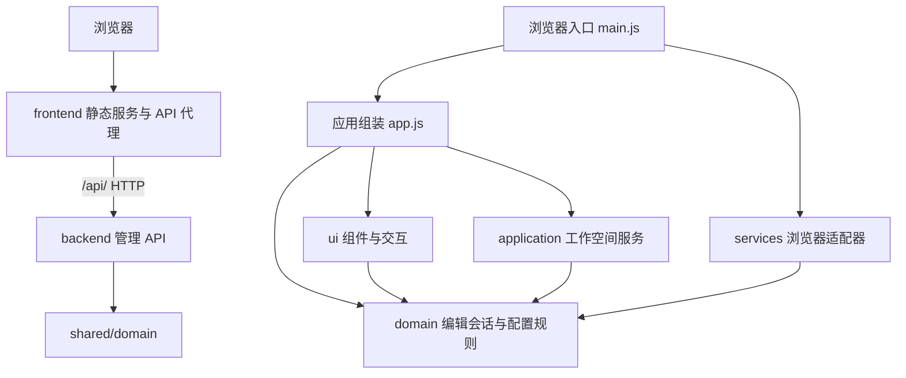

# Palbox 模块与依赖

Palbox 使用原生 ES Modules 和 Node.js 内置 HTTP 服务。前端、后端独立启动和部署，领域规则位于 `shared/domain/`，双方均不依赖对方的实现目录。保持无构建步骤；Playwright 只是开发测试依赖。

## 边界

| 层 | 职责 | 允许直接依赖 |
| --- | --- | --- |
| `domain` | INI 解析与序列化、参数识别、字段验证、编辑草稿、工作空间数据约束 | 领域模块 |
| `application` | 配置新建／切换／重命名／删除、持久化协调、保存失败回滚 | 应用与领域模块；注入的仓库接口 |
| `services` | 服务器 API 与远程保存队列、剪贴板兼容处理、UTF-8 文件读取与大小限制 | 服务与领域模块 |
| `ui` | 表单、参数表、源码编辑、列表、统计、弹窗、导航和反馈 | 界面与领域模块；注入的回调 |
| `main.js` / `app.js` | 创建并连接上述对象 | 各层公开接口 |

领域和应用层不访问 DOM、`window` 或 `localStorage`。界面通过编辑会话读取和修改参数，通过回调发起工作空间操作；不直接读写存储。没有共享的浏览器全局对象，也没有模块循环依赖。`tests/unit/architecture.test.js` 会持续检查这些边界。

## 数据流

1. `main.js` 创建参数目录、存储仓库、剪贴板和文件适配器，再注入应用。
2. `WorkspaceService` 读取已保存配置并管理活动配置；`EditorSession` 持有当前配置的已应用参数、有效编辑、输入错误和源码草稿。
3. 表单与参数表提交原始值，由编辑会话验证。输入错误保留草稿和上一次有效参数值。数值显示共用编辑会话的 `outputRaw()`，加载与重新渲染时和输出一致；输入期间不重写光标，失焦时将有效值补齐并写回编辑会话，非法草稿保留原样。
4. 源码经过完整解析和修改字段验证后才应用。失败不会替换当前已应用配置。文件和粘贴导入通过 `/api/default-configuration` 重新获取当前官方默认内容，`mergeConfiguration()` 按默认顺序覆盖同名参数、保留缺项、追加导入独有参数，再强制打开 REST API 并保留官方默认中的随机管理员密码，然后创建独立配置；默认文件缺失或请求失败时保持导入对话框和输入供重试。配置列表中点击条目后的「导入配置」覆盖该条目的当前参数，不新建配置，同样强制打开 REST API 并保留该条目已有的管理员密码。所有配置的 `initialSource` 都使用「游戏默认配置」的官方默认基准，输入源码只读；未修改的配置随官方文件更新，已修改的配置保留参数并补上新增官方参数。新导入配置的差异相对该基准展示，恢复时回到官方默认。
5. 每次编辑回调把当前有效源文件同步交给工作空间服务自动保存；未应用源码和非法输入保留为独立草稿。编辑会话以配置的 `initialSource` 作为修改比较基准，表单和参数列表通过同一组件显示「已修改」铭牌，刷新和切换配置后仍可识别改动；数字比较使用统一输出格式，补零不产生修改标记。自动保存不重置编辑会话、不重新渲染输入框，避免丢失光标、错误草稿和修改统计。是否仍有未保存内容由有效源文件与工作空间已保存内容、草稿状态和持久化状态共同判断，与修改铭牌分开计算。失败时保留编辑结果并回滚已保存源文件。
6. 输出与复制通过编辑会话生成完整 INI，复制再调用剪贴板适配器。目录按模板中的小数格式提供输出格式化规则，仅对已识别的数值字段补齐小数位，不舍入已有精度、不修改编辑状态或服务器存储。筛选、搜索和分类均不改变实际参数顺序或复制内容。

页面分类、搜索词和视图切换只属于 `EditorPanel`，不会混入工作空间记录。

## 存储兼容

工作空间统一保存在服务器的 `palbox/workspace.json`，数据形状为 `{ workspace: { version: 1, activeId, profiles }, revision }`。各配置保留名称、ID、原始源码与 `initialSource` 恢复基准。存在「游戏默认配置」时，每套配置的恢复基准都固定为该条目的官方默认内容，保存时也会写回这一基准。官方文件尚未出现时，缺少恢复基准的旧记录沿用原 `source`。

配置加载失败时显示错误，不创建浏览器本地工作空间。保存失败时远程仓库保留最新编辑并提供重试，服务器使用版本号避免并发覆盖。

## 扩展位置

- 添加参数说明：官方字段在 `shared/domain/schema.js` 中维护，社区字段在 `shared/domain/community-fields.js` 中维护。元数据提供中文名称、用途、控件及 `verification` 状态和来源；社区字段仅在模板包含该字段且有说明来源时进入目录，以“未验证”铭牌呈现状态。来源为当前用户补充时使用 `user-provided`，不冒充外部文档。`catalog.js` 统一控制表单、验证、搜索与三种状态统计，未知新字段不会因模板出现而自动识别。界面通过 `parameter-evidence.js` 统一呈现状态铭牌与悬浮提示说明，来源仅在元数据和文档保留。详见 [参数明细](parameters.md)。
- 更新默认参数：管理后端从游戏目录的 `DefaultPalWorldSettings.ini` 读取当前版本默认值，新建配置通过认证接口 `/api/default-configuration` 获取；配置库为空时删除后创建的默认配置也使用该来源，存在服务端游戏默认条目时则直接保留该条目并切换过去。安装前的最少管理项通过配置库中的待初始化标记跟踪，安装后仅替换尚未编辑的占位配置，并更新恢复基准和版本号。
- 游戏默认项：配置库维护一条服务端所有的 `locked` 条目，以 `DefaultPalWorldSettings.ini` 为输入，经过管理项补齐：启用 REST API、生成并保留管理员密码、设置公布端口。服务端固定其名称、来源、`locked` 标记和恢复基准；客户端可通过参数表单修改参数并应用该条目。所有配置的输入源码都只读。读取配置库、面板启动以及安装/更新任务后同步文件：未修改的配置按新文件重建工作源码；已修改的其他配置保留参数并补上新增官方参数；已修改的游戏默认条目保留工作源码。每套配置的恢复基准都推进到当前官方默认（沿用已生成的密码）。保存接口把其他配置的恢复基准写回这一官方内容，忽略游戏默认条目的名称、来源和基准修改，并自动补回被删除的条目。旧版来源为官方默认文件的普通配置在加载时迁移为“基于官方默认配置”，参数仍可在表单中修改。`shared/domain/template.js` 保留为参数目录和测试的参考快照，不作为管理模式中新建配置的游戏参数来源。未知新字段仍然属于未识别参数，已有用户配置不自动覆盖。
- 更换存储：实现 `{ load(), save(workspace) }` 仓库接口，在入口替换适配器。工作空间服务不需要更改。
- 更换剪贴板或文件实现：提供 `{ write(text) }` 或 `{ read(file), validate(source) }`，在入口注入；组件不访问具体实现。
- 调整外观：修改 `frontend/public/styles/tokens.css` 的设计变量，或对应的样式模块；`index.css` 明确控制加载顺序。

## 服务与验证

`backend/index.js` 负责管理初始化、启动任务和退出时保存停服；`backend/http-server.js` 仅暴露 `/api/` 和 `/healthz`，不发布网页或源码。默认后端监听 `127.0.0.1:8081`。

`frontend/index.js` 独立启动静态资源与 API 代理服务，默认监听 `127.0.0.1:8080`。`frontend/http-server.js` 只发布 `frontend/public`、`frontend/src`、`shared/domain` 和浏览器测试资源，不发布后端、Node 测试或工作区元数据；路径和符号链接必须保持在对应发布目录中。`/src/` 对应浏览器源码，`/shared/domain/` 对应共享规则，因此浏览器与 Node 使用同一套 ES Modules，无需构建或复制规则。

前端通过 `PALBOX_API_URL` 选择后端，浏览器始终请求同源 `/api/`。代理保留公开站点的 Host、Origin、Cookie 和 CSRF 标头，认证继续执行现有来源校验；请求和响应以流传输，支持大存档上传、下载和取消。后端不可达时返回 JSON 502，静态页面仍可访问。无需开放跨域凭据。若替换为其他静态服务器，需为 `/api/` 配置同源代理并保留原始 Host 和 Origin。

代理默认使用直连地址，仅采信 `PALBOX_TRUSTED_PROXIES` 显式列出的 IP/CIDR，按转发链从右向左停在第一个非可信地址，非法链拒绝解析；内网地址没有隐式代理权限。前端覆盖写入 `X-Palbox-Client-IP` 与 `X-Forwarded-For`，后端也通过独立的可信列表决定是否采信。后端原生默认信任精确回环地址，Compose 则只信任专用网络中的前端固定地址，用于登录限流、登录审计和首次初始化来源判断。静态资源和代理响应附带 CSP、X-Frame-Options、Referrer-Policy、Permissions-Policy 等安全头。

`npm start` / `dev.sh` 使用 `scripts/start.js` 启动两个独立进程，任一进程退出时停止另一个，收到退出信号时等待后端完成停服。也可分别执行 `start:frontend`、`start:backend`；开发命令使用相应的 `dev:*`。Docker 的 `frontend` 和 `backend` 构建目标分别只复制自身目录与共享规则。Compose 仅向宿主机暴露前端 HTTP 和游戏 UDP，后端 HTTP 通过内部网络供代理使用。

`npm test` 运行单元和 HTTP 集成测试。`npm run test:e2e` 独立启动本机服务，检查真实浏览器交互并在结束后释放服务。共用配置用例同时由 Node.js 单元测试和浏览器测试页面执行。

## 管理模式

`install.sh` 提供 Ubuntu / Debian 原生就地安装：缺少 `curl`、`lib32gcc-s1` 或 `7zip` 时才安装对应缺失项，已可用则不更新软件源；并准备校验后的 `.runtime/node`，使用项目所属的已有普通用户，新数据统一放在当前项目的 `data/`，不创建系统用户、搬迁程序或建立版本链接。配置保存在项目的 `.palbox.env`；终端与 systemd 均调用 `dev.sh`，由 Node.js `--env-file` 加载同一配置，再由 `scripts/start.js` 协调前后端并检查实际运行用户。新数据目录自动设置用户权限，已有数据无权限时中止提示。systemd 使用 `KillMode=mixed` 先交由面板正常停服，再清理残留进程。安装器检查前后端连通，失败恢复原部署配置；代码与应用写入的数据不回退。安装器不下载 SteamCMD，仍由网页任务安装。`sudo bash ./install.sh --uninstall` 停止服务、取消开机启动并移除本项目的 `palbox.service`，保留 `data/`、`.palbox.env` 和程序。系统命令模拟测试覆盖原地安装、用户选择、重复安装、权限检查、下载校验与配置回退，真实终端启动用例验证配置与项目运行时共用。

Linux 原生运行时，SteamCMD 默认位于数据目录的 `steamcmd/`；`steamcmd.js` 负责下载官方安装包、限制下载大小、解压、自更新与就绪标记。安装包下载和 SteamCMD 自更新不设时长上限，面板关闭时才会中止。安装和更新游戏服务端时，是否沿用代理由游戏服务栏的「自动代理」决定，保存在 `settings.json` 的 `autoProxy`，默认关闭。关闭时 SteamCMD 不继承 `http_proxy`、`https_proxy` 等代理变量，直接连接下载；开启后沿用面板进程环境中的代理。SteamCMD 自身初始化仍沿用环境。网页通过已有 `/api/tasks` 提交 `install-steamcmd`，沿用管理员认证、CSRF、任务互斥、状态推送和安装日志。失败时不写入就绪标记，可以重试；关闭面板会中止下载并终止安装进程。自动安装使用数据目录内的 `steam-home/` 作为子进程主目录并准备 SDK 链接，不改变宿主用户的 Steam 配置。显式配置的 `PALBOX_STEAMCMD` 仅检测和使用，不由网页覆盖，Docker 沿用镜像预装路径。

后端使用 `backend/management`。`files.js` 提供写入临时文件、fsync 和原子替换；`store.js` 在服务器保存工作空间并检查版本冲突；`auth.js` 管理管理员用户名与异步 scrypt 密码校验（限制并发哈希）、HttpOnly 会话、CSRF 验证、按客户端地址的失败冷却和登录审计；`api.js` 提供固定的 JSON API 与备份下载，不提供任意命令执行，JSON 请求体带大小上限和绝对读取超时；`save-imports.js` 负责世界存档和完整备份上传的流式落盘、`.tar.gz` / `.zip` / `.7z` 安全校验、类型与布局识别、全部内容校验及临时暂存。`.zip` 和 `.7z` 由系统 7zip 列出并解压。全新部署没有 `palbox/settings.json` 时进入首次初始化状态，由 `/api/setup` 创建管理员，仅接受回环或内网来源；旧版缺少用户名的配置会被拒绝启动。

`runtime.js` 管理 SteamCMD 和游戏进程组，使用参数数组启动子进程，处理 REST API、日志轮换、就绪等待和停服。游戏启动参数保存在 `settings.json` 的 `gameArgs`，由 `manager.js` 在初始化和设置更新时同步到 `runtime.args`，所有启动与自动重启路径共用同一份参数。世界存档和完整备份通过 `/api/save-import` 流式上传并暂存到 `palbox/imports`，校验通过后由 `import-save` 任务停服、创建导入前备份；完整备份整体替换 `Pal/Saved`，世界包整体替换当前世界 ID 目录，包内的全部文件和子目录均保留。`replace-directory.js` 先准备新目录，再移走旧目录并安装新目录，失败时回滚，回滚失败则保留原数据并保持停服。导入后恢复原运行状态。`manager.js` 串行执行后台任务，处理应用配置、停服备份、归档路径校验、临时目录恢复；应用配置不创建备份，恢复、导入和重置前的世界备份分别写入 `before-restore`、`before-import`、`before-reset`，与 `manual` 手动备份独立保留和展示；分类数量保存在 `settings.json` 的 `backupRetentions` 中，按分类清理，旧的 `backupRetention` 数字作为初始回退值；后端监听端口后会按 `settings.json` 的 `autoStart` 设置自动提交一次启动任务（未安装、未初始化、已在运行或正在关闭时跳过）。`native-backups.js` 识别官方世界快照、验证文件与路径、在线导出并在停服后恢复对应世界；面板不再运行自动备份定时器。面板进程与游戏进程分开管理，游戏停服不会关闭网页。

`/api/status?scope=overview` 按需读取游戏的 `info`、`metrics`、`players`，`scope=players` 只读取玩家，`scope=local` 只读取面板本地状态。网页进入对应页面、手动刷新和操作完成时请求一次，不运行状态轮询定时器。`status-stream.js` 通过 `/api/status/stream` 推送 Manager/Runtime 的任务、阶段和进程事件，仅生成本地快照，不访问游戏 REST；15 秒心跳用于保持连接并检查会话。状态版本绑定面板进程实例，前端忽略过时响应和重启前的延迟响应，同一游戏进程的本地快照保留最近按需读取的数据，停服或更换进程时清空。状态与日志订阅在页面隐藏时断开、恢复时重连，账号凭据轮换时共用重连机制。启动任务内仍有带超时的接口就绪检查。

写接口在读取请求体后和排队执行时重新验证原请求的会话与 CSRF；工作空间、设置和账号安全写入还会在原子替换前检查授权。上传在接收分块、扫描后及元数据提交前检查会话。退出或轮换使未提交的旧会话请求失效；已接纳的管理任务继续执行。上传用单请求锁、绝对读取时限、暂存数量及总量配额约束资源；gzip 实际输出量和 tar 清单均在流中计数，超限会终止扫描进程并等待流退出，再清理文件。

手动、恢复前、导入前和重置前世界备份都打包当前世界目录和当时的 `PalWorldSettings.ini`，目录结构与官方备份下载相同。没有可读世界时，后三类只打包已有的 `PalWorldSettings.ini`。创建时将当时的世界 ID 记录在归档旁的 `.tar.gz.json` 元数据文件中。列表接口读取已记录 ID；旧归档缺少元数据时先读取归档中的 `GameUserSettings.ini`，没有配置时从唯一的 `Pal/Saved/SaveGames/0/<世界 ID>/Level.sav` 或新包根目录的 `<世界 ID>/Level.sav` 识别，并缓存结果。缓存与归档的 inode、大小和修改时间等信息绑定，归档变动后重新识别，删除或保留清理时一并移除元数据。世界备份恢复统一替换当前加载的世界目录，新旧归档都保持当前世界 ID、其他世界和外部数据不变；仅含配置的归档独立恢复配置。导入存档和世界备份恢复若带有 `PalWorldSettings.ini`，都用 `mergeConfiguration` 以官方默认配置为底补全缺项后写入「游戏默认配置」，并同步到游戏配置。REST API 固定为开启，管理员密码沿用该配置已有的随机密码，不采用包内的这两项。存档目录的替换方式不变。备份恢复、官方快照恢复和存档导入共用 `save-import-dialog.js`；上传后或选择备份后通过 `POST /api/restore-preview` 只读检测内容，返回来源世界 ID、目标世界 ID、实际目录、配置处理、保护备份及运行状态。配置合并与长度检查在预览和执行前完成，预览不会改变配置库。确认时提交 `targetWorldId`，执行前及停服后检查当前目标，变化时拒绝并要求重新检测。世界备份恢复不再接受 `full`，省略 `mode` 或旧客户端传入 `world` 均只恢复当前世界。

`backup-paths.js` 为世界备份的创建、列表、下载、恢复、删除、保留清理及官方备份临时目录提供统一父目录检查，拒绝 `backups` 和分类目录的符号链接。下载使用 `O_NOFOLLOW` 并核实打开的对象为普通文件。配置的数据根目录属于受信任边界；这些检查不提供对恶意本地写入者并发替换目录的隔离。

日志窗口默认使用 `channel=all` 合并三个来源，保留原有 `game`、`steamcmd`、`palbox` 筛选。`Runtime.log()` 同时记录原始分类日志和带时间、来源的 `combined.jsonl`，合并视图重组同一来源的跨块输出，以接收顺序显示日志行；历史记录在首次初始化时按来源导入一次，新记录在刷新和重启后仍可读取。日志通过 `/api/logs/stream` 的 SSE 连接独立推送，不依赖状态轮询。`logs.js` 监听日志目录的写入和轮换，并每秒检查一次作为后备；网页使用 `format=pages` 首次加载最近最多 64 KiB 原始日志，随后按游标增量推送，保留代理流式传输和背压；旧快照格式继续兼容。连接使用原有会话认证，退出登录或会话过期后终止。前端切换频道、隐藏页面或离开日志视图时关闭连接，恢复可见时重新加载最近一页；网络断线后使用 SSE 的 `Last-Event-ID` 继续读取。分类日志写入时按行添加与合并记录一致的 UTC 毫秒时间戳；跨块输出只添加一次前缀，进度回车重复该行原有时间，新行使用新的接收时间。子进程的 stdout、stderr 分别流式解码 UTF-8，读取尾部时跳过截断字符；显示层清理 ANSI 和进度控制码；分类日志保留时间戳与原始内容，合并记录保留独立时间字段。

登录审计使用独立的 `login` 日志频道，写入 `logs/login.log`，不写入 `combined.jsonl`。首次初始化登录日志时从旧面板日志尾部复制可识别的登录事件，后续不会重复导入；运行日志读取时排除旧登录事件。左侧「登录日志」通过 `#login-logs` 直接进入，`login-logs-panel.js` 订阅同一套认证 SSE 接口，仅在该页面可见时连接，离开、隐藏或会话失效时断开。

浏览器入口先请求 `/api/bootstrap` 检查管理服务、初始化与登录状态：未初始化时转入 `/setup.html` 创建管理员，未登录时转入登录页；管理服务不可用时显示错误。远程仓库保留同步编辑接口，将服务器写入串行排队，通过订阅状态区别「保存中」「已保存」「保存失败」。服务器确认前会保留离开提醒，失败时保留最新草稿；并发版本冲突不会静默覆盖。配置应用前等待队列写入完成，再携带配置 ID 和版本号提交任务。

`reset-save` 是串行管理任务，要求请求中的 `confirmation` 严格等于 `delete`，并在接纳任务、执行任务及删除前检查游戏进程未运行。`NativeBackups.clearWorlds()` 验证 Saved/SaveGames/0 的各级目录，逐项移除 `0` 下的所有内容并保留目录本身；父路径为符号链接时拒绝操作，子条目为符号链接时仅删除链接。重置不创建备份、不改变游戏配置或启动游戏，任务结束后通过状态推送刷新存档列表。

`running-config-panel.js` 将 `/api/running` 的 settings 对象映射到现有 schema 分类与说明，仅展示返回的键，不加载配置草稿或补默认值。可视化面板保留 JSON 值类型，显示只读输入、布尔状态、平台列表及复杂对象，未知参数单独分组；原始 JSON 可随时查看。密码默认隐藏，关闭时清理已显示数据；搜索与分类在本地完成。

原有编辑器只处理预设和草稿；游戏配置的写入必须经过管理任务。`frontend/src/ui/management-panel.js` 通过注入的 API 客户端展示状态、任务、日志、备份和玩家操作。服务端数据位于 `/data`，具体结构见 [Docker 文档](docker.md)。

`banned-players.js` 优先解析部分新版本的 `Pal/Saved/SaveGames/Config/banlist.json`；该路径不存在时自动回退旧版 `Pal/Saved/SaveGames/banlist.txt`（两种路径都可能因服务端版本不同而不存在，属正常情况），兼容 `steam_<ID>,<PlayerUID>` 迁移格式，检查发布目录边界与文件大小，合并重复 ID 并报告无法识别的记录；`GET /api/banned-players` 需要登录，停服时也可读取。名单以游戏文件为准，不依赖有限的面板任务历史推断封禁状态；新版游戏停服时才写回名单，因此近期成功的面板封禁/解封任务会与文件快照合并，保证运行中刚封禁的玩家立即可见并可解封；任务记录同时用于补充昵称、理由与时间。解封沿用串行任务和官方 REST API，只有真实调用成功才标记任务完成。界面区分在线与封禁列表、空状态和读取失败，解封须确认；服务卡片保留常用操作，维护参数、更新和强制停止折叠展示。

日志保留由 `backend/management/log-retention.js` 统一管理。默认五类日志按 UTC 自然日归档，普通日志保留含当天在内的最近 7 天，面板登录记录 `login.log` 单独保留 15 天。当天文件使用固定名称，跨日写入或清理时移为 `game.log.YYYY-MM-DD` 等日期文件；每天每类每文件 5 MiB，额外保留四份容量分卷（每天每类最多 5 个文件），超额仅覆盖当天最旧内容。写入前按完整 JSON 记录或 UTF-8 边界拆分，单次超大输出只写当天容量范围内的尾部。Runtime 在初始化及每小时清理，跨日写入也清理该来源的过期日期文件；日期保留依据文件名，无日期旧文件按修改时间迁移。原子收缩旧超大文件时保留原修改时间。清理忽略其他文件、目录和符号链接，错误单独报告且不终止游戏进程；定时器不阻止进程退出，关闭 Runtime 时释放。读取按当前文件、当天分卷、日期归档顺序补足尾部窗口，总读取量保持有界，并按 inode 去重以处理并发轮换。分页和玩家历史恢复共用日志文件排序规则，游标在跨日改名后继续按 inode 读取。保留策略可通过 `PALBOX_LOG_MAX_MB`、`PALBOX_LOG_BACKUPS`、`PALBOX_LOG_RETENTION_DAYS` 和独立的 `PALBOX_LOGIN_LOG_RETENTION_DAYS` 配置。

`log-pages.js` 为 `/api/logs/history` 和分页 SSE 提供同一套读取逻辑，每页最多四个 16 KiB 字节块。游标绑定频道、文件 inode/创建时间及偏移，校验文件前缀和偏移前的摘要，文件轮换后按身份接续读取；截断或清理导致的位置失效会显式报告缺口。前后翻页和增量更新均有界读取，拒绝符号链接与跨频道游标。`frontend/src/services/log-history.js` 按块身份合并和替换局部更新，使用 `shared/domain/logs.js` 跨块解码 UTF-8、JSON 和终端进度，保留已加载内容，并避免历史请求覆盖同时到达的新日志。活动窗口最多 128 块（2 MiB）；达到上限时提示暂停实时更新，继续加载历史会切换到更早窗口，返回最新后恢复。运行日志向上滚动、登录日志向下滚动可继续加载，也可使用「加载更早日志」按钮；读取位置在新增或补充历史时保留。运行日志视图通过 `log-display.js` 仅移除空白行及仅含时间、来源前缀的空行，保留所有有内容的记录和原有缩进；不按接口或消息内容过滤，原始文件和日志 API 不受影响。

## TOTP 二次验证

`backend/management/totp.js` 使用 Node.js crypto 实现 RFC 4226/6238 的 SHA-1、6 位验证码和 30 秒步长；校验接受前后各一个时间步，最近已使用的步号持久化，拒绝重放。恢复码使用独立随机数，服务器只保存 SHA-256 摘要，每个仅能使用一次。密钥及消费状态位于 `settings.json` 的 `admin.totp`；账号写入与普通设置共用串行队列和原子替换，避免并发登录重复消费或设置更新覆盖验证码状态。已有配置缺少此字段时保持密码登录，字段损坏时拒绝启动。

`POST /api/security/username` 对新用户名沿用初始化的规范化及校验规则，要求当前密码和已启用的第二因素。通过 `Manager.updateAdmin()` 串行写入并在提交前再次授权，仅更新用户名及第二因素的消费记录。会话与登录挑战签名包含用户名，改名会撤销旧会话、挑战和未完成的验证器绑定，重新签发当前浏览器会话并重连实时流；已启用的验证器秘密不变。写入失败时不消费恢复码、不更改账号或撤销现有会话。

密码校验成功且启用 TOTP 时，`/api/login` 只返回 5 分钟有效、绑定客户端地址和账号验证设置的一次性挑战；`/api/login/totp` 验证成功后才发放完整会话。挑战最多允许 5 次失败，二次验证与密码使用同一套 IP 冷却计数，同时增加管理员账号的第二因素失败预算（5 分钟内累计 10 次失败冷却 5 秒）；重新验证密码、切换 IP 均不清零，伪造或过期挑战不计入账号预算。写入队列内再次检查共享预算，防止并发越过阈值；冷却结束或成功验证后可重新尝试。启用、关闭或重新生成恢复码均要求已登录、来源和 CSRF 校验；绑定先再次验证密码，再确认一次动态码，其他安全更改要求密码与第二因素。更改成功后清除全部旧会话、挑战和绑定，重新签发当前浏览器的 Cookie 和 CSRF；客户端更新凭据并重连日志，忽略旧连接的过期事件。

`POST /api/security/password` 要求已登录、同源、CSRF 和当前密码验证，新密码需 12–1024 位且与当前密码不同；启用 TOTP 时还需动态验证码或恢复码。新密码使用独立随机盐和 scrypt 摘要，与第二因素消费状态一起串行原子写入；写入前再次检查原会话授权。成功后清除旧会话、挑战和绑定，为当前浏览器签发新的 Cookie 和 CSRF，记录不含密码的审计日志。

`frontend/src/ui/account-security.js` 提供侧栏「账号」弹窗，显示当前用户名，支持修改用户名、修改密码、二维码扫码或手动密钥绑定、一次性恢复码展示和复制、恢复码更新及关闭，退出登录也位于账号弹窗底部；`frontend/src/login.js` 管理密码、动态码与恢复码的分步登录。密码表单校验两次新密码一致，成功及弹窗关闭时清除密码字段；绑定二维码、密钥和恢复码在弹窗关闭后从 DOM 清除；秘密不交给第三方服务。TOTP 算法与配置格式以 RFC 测试向量和实际 HTTP、浏览器流程验证。

二维码由 `frontend/src/ui/totp-qr.js` 按验证器的 `otpauth://totp/` URI 格式编码，使用固定版本的 [qrcode-generator 2.0.4](https://github.com/kazuhikoarase/qrcode-generator/tree/js2.0.4) 在浏览器本地生成 SVG 图片，保留原始 MIT 许可证于 `frontend/src/ui/vendor`，不依赖 CDN 或第三方二维码服务。
