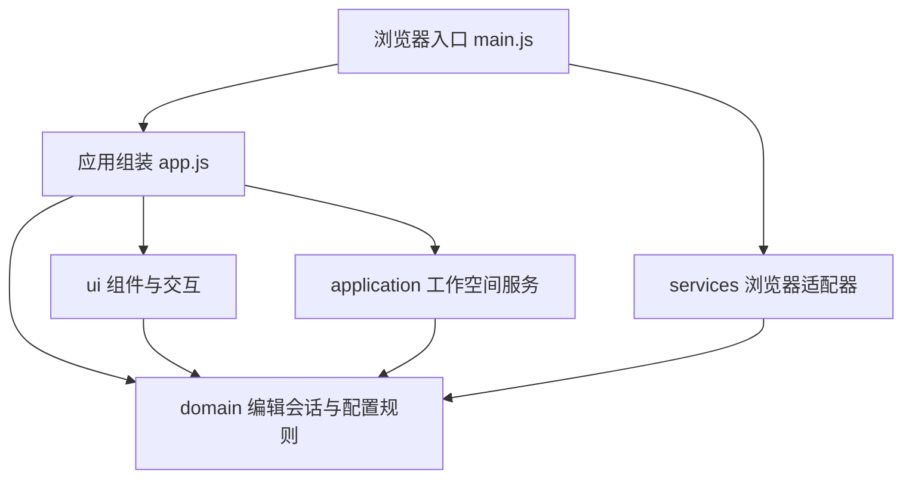

# Palbox 模块与依赖

Palbox 使用原生 ES Modules 和 Node.js 内置 HTTP 服务。保持无构建步骤；Playwright 只是开发测试依赖。

## 边界

| 层 | 职责 | 允许直接依赖 |
| --- | --- | --- |
| `domain` | INI 解析与序列化、参数识别、字段验证、编辑草稿、工作空间数据约束 | 领域模块 |
| `application` | 配置新建／切换／重命名／删除、持久化协调、保存失败回滚 | 应用与领域模块；注入的仓库接口 |
| `services` | `localStorage` 读写、剪贴板兼容处理、UTF-8 文件读取与大小限制 | 服务与领域模块 |
| `ui` | 表单、参数表、源码编辑、列表、统计、弹窗、导航和反馈 | 界面与领域模块；注入的回调 |
| `main.js` / `app.js` | 创建并连接上述对象 | 各层公开接口 |

领域和应用层不访问 DOM、`window` 或 `localStorage`。界面通过编辑会话读取和修改参数，通过回调发起工作空间操作；不直接读写存储。没有共享的浏览器全局对象，也没有模块循环依赖。`tests/unit/architecture.test.js` 会持续检查这些边界。

## 数据流

1. `main.js` 创建参数目录、存储仓库、剪贴板和文件适配器，再注入应用。
2. `WorkspaceService` 读取已保存配置并管理活动配置；`EditorSession` 持有当前配置的已应用参数、有效编辑、输入错误和源码草稿。
3. 表单与参数表提交原始值，由编辑会话验证。输入错误保留草稿和上一次有效参数值。
4. 源码经过完整解析和修改字段验证后才应用。失败不会替换当前已应用配置。
5. 保存时将有效源文件交给工作空间服务。存储成功后才重置编辑基线；失败时保留编辑结果并回滚已保存源文件。
6. 复制通过编辑会话生成完整 INI，再调用剪贴板适配器。筛选、搜索和分类均不改变实际参数顺序或复制内容。

页面分类、搜索词和视图切换只属于 `EditorPanel`，不会混入工作空间记录。

## 存储兼容

继续使用 `palbox.workspace.v1`，数据形状不变：`{ version: 1, activeId, profiles: [{ id, name, source, updatedAt }] }`。已有记录直接读取，源文件、名称和 ID 不变，没有自动补参或迁移覆盖。

存储不可用时可在内存继续编辑并复制。若旧记录损坏，则进入临时工作空间并阻止写入原始存储。配置格式验证与存储格式验证相互独立。

## 扩展位置

- 添加参数说明：官方字段在 `src/domain/schema.js` 中维护，社区字段在 `src/domain/community-fields.js` 中维护。元数据提供中文名称、用途、控件及 `verification` 状态和来源；社区字段仅在模板包含该字段且有说明来源时进入目录，以“未验证”铭牌呈现状态。来源为当前用户补充时使用 `user-provided`，不冒充外部文档。`catalog.js` 统一控制表单、验证、搜索与三种状态统计，未知新字段不会因模板出现而自动识别。界面通过 `parameter-evidence.js` 统一呈现状态铭牌与悬浮提示说明，来源仅在元数据和文档保留。详见 [参数明细](parameters.md)。
- 更新默认参数：修改 `src/domain/template.js` 的参数列表。模板只定义新建配置的默认值与原始顺序，不参与识别判定；没有官方或社区用途说明的新字段仍然属于未识别参数。已有配置不自动覆盖。
- 更换存储：实现 `{ load(), save(workspace) }` 仓库接口，在入口替换适配器。工作空间服务不需要更改。
- 更换剪贴板或文件实现：提供 `{ write(text) }` 或 `{ read(file), validate(source) }`，在入口注入；组件不访问具体实现。
- 调整外观：修改 `public/styles/tokens.css` 的设计变量，或对应的样式模块；`index.css` 明确控制加载顺序。

## 服务与验证

`server/index.js` 只处理端口和启动错误；`server/http-server.js` 提供可测试的 `createServer()`。它只发布 `public`、浏览器源码和浏览器测试资源，不发布服务端、Node 测试或工作区元数据；路径和符号链接必须保持在对应发布目录中。

`npm test` 运行单元和 HTTP 集成测试。`npm run test:e2e` 独立启动本机服务，检查真实浏览器交互并在结束后释放服务。共用配置用例同时由 Node.js 单元测试和浏览器测试页面执行。
