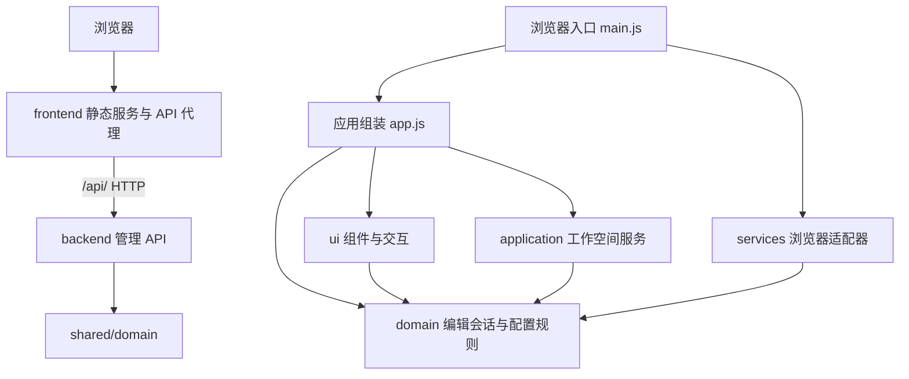

# Palbox 模块与依赖

Palbox 使用原生 ES Modules 和 Node.js 内置 HTTP 服务。前端、后端独立启动和部署，领域规则位于 `shared/domain/`，双方均不依赖对方的实现目录。保持无构建步骤；Playwright 只是开发测试依赖。

## 边界

| 层 | 职责 | 允许直接依赖 |
| --- | --- | --- |
| `domain` | INI 解析与序列化、参数识别、字段验证、编辑草稿、工作空间数据约束 | 领域模块 |
| `application` | 配置新建／切换／重命名／删除、持久化协调、保存失败回滚 | 应用与领域模块；注入的仓库接口 |
| `services` | 服务器 API 与远程保存队列、剪贴板兼容处理、UTF-8 文件读取与大小限制 | 服务与领域模块 |
| `ui` | 表单、参数表、源码编辑、列表、统计、弹窗、导航和反馈 | 界面与领域模块；注入的回调 |
| `main.js` / `app.js` | 创建并连接上述对象 | 各层公开接口 |

领域和应用层不访问 DOM、`window` 或 `localStorage`。界面通过编辑会话读取和修改参数，通过回调发起工作空间操作；不直接读写存储。没有共享的浏览器全局对象，也没有模块循环依赖。`tests/unit/architecture.test.js` 会持续检查这些边界。

## 数据流

1. `main.js` 创建参数目录、存储仓库、剪贴板和文件适配器，再注入应用。
2. `WorkspaceService` 读取已保存配置并管理活动配置；`EditorSession` 持有当前配置的已应用参数、有效编辑、输入错误和源码草稿。
3. 表单与参数表提交原始值，由编辑会话验证。输入错误保留草稿和上一次有效参数值。数值显示共用编辑会话的 `outputRaw()`，加载与重新渲染时和输出一致；输入期间不重写光标，失焦时将有效值补齐并写回编辑会话，非法草稿保留原样。
4. 源码经过完整解析和修改字段验证后才应用。失败不会替换当前已应用配置。
5. 每次编辑回调把当前有效源文件同步交给工作空间服务自动保存；未应用源码和非法输入保留为独立草稿。自动保存不重置编辑会话、不重新渲染输入框，避免丢失光标、错误草稿和本次修改统计。是否仍有未保存内容由有效源文件与工作空间已保存内容、草稿状态和持久化状态共同判断。失败时保留编辑结果并回滚已保存源文件。
6. 输出与复制通过编辑会话生成完整 INI，复制再调用剪贴板适配器。目录按模板中的小数格式提供输出格式化规则，仅对已识别的数值字段补齐小数位，不舍入已有精度、不修改编辑状态或服务器存储。筛选、搜索和分类均不改变实际参数顺序或复制内容。

页面分类、搜索词和视图切换只属于 `EditorPanel`，不会混入工作空间记录。

## 存储兼容

工作空间统一保存在服务器的 `palbox/workspace.json`，数据形状为 `{ workspace: { version: 1, activeId, profiles }, revision }`。各配置保留名称、ID、原始源码与 `initialSource` 恢复基准。旧记录缺少恢复基准时沿用原 `source`，后续保存不会覆盖基准。

配置加载失败时显示错误，不创建浏览器本地工作空间。保存失败时远程仓库保留最新编辑并提供重试，服务器使用版本号避免并发覆盖。

## 扩展位置

- 添加参数说明：官方字段在 `shared/domain/schema.js` 中维护，社区字段在 `shared/domain/community-fields.js` 中维护。元数据提供中文名称、用途、控件及 `verification` 状态和来源；社区字段仅在模板包含该字段且有说明来源时进入目录，以“未验证”铭牌呈现状态。来源为当前用户补充时使用 `user-provided`，不冒充外部文档。`catalog.js` 统一控制表单、验证、搜索与三种状态统计，未知新字段不会因模板出现而自动识别。界面通过 `parameter-evidence.js` 统一呈现状态铭牌与悬浮提示说明，来源仅在元数据和文档保留。详见 [参数明细](parameters.md)。
- 更新默认参数：管理后端从游戏目录的 `DefaultPalWorldSettings.ini` 读取当前版本默认值，新建配置通过认证接口 `/api/default-configuration` 获取；配置库为空时删除后创建的默认配置也使用该来源，存在服务端游戏默认条目时则直接保留该条目并切换过去。安装前的最少管理项通过配置库中的待初始化标记跟踪，安装后仅替换尚未编辑的占位配置，并更新恢复基准和版本号。
- 游戏默认项：配置库维护一条服务端所有的 `locked` 条目，以 `DefaultPalWorldSettings.ini` 原文作为初始输入，不经过管理项补齐。服务端固定其名称、来源、`locked` 标记和恢复基准；客户端可通过普通保存流程修改其参数源码，因此可以选择和应用该条目，但前端高级编辑中的输入源码保持只读。读取配置库、面板启动以及安装/更新任务后同步文件：未修改参数时同时更新工作源码和恢复基准，已修改时保留工作源码、仅推进恢复基准；保存接口忽略名称、来源和基准的客户端修改，并自动补回被删除的条目。旧版来源为官方默认文件的普通配置在加载时迁移为“基于官方默认配置”，仍可编辑。`shared/domain/template.js` 保留为参数目录和测试的参考快照，不作为管理模式中新建配置的游戏参数来源。未知新字段仍然属于未识别参数，已有用户配置不自动覆盖。
- 更换存储：实现 `{ load(), save(workspace) }` 仓库接口，在入口替换适配器。工作空间服务不需要更改。
- 更换剪贴板或文件实现：提供 `{ write(text) }` 或 `{ read(file), validate(source) }`，在入口注入；组件不访问具体实现。
- 调整外观：修改 `frontend/public/styles/tokens.css` 的设计变量，或对应的样式模块；`index.css` 明确控制加载顺序。

## 服务与验证

`backend/index.js` 负责管理初始化、启动任务和退出时保存停服；`backend/http-server.js` 仅暴露 `/api/` 和 `/healthz`，不发布网页或源码。默认后端监听 `127.0.0.1:8081`。

`frontend/index.js` 独立启动静态资源与 API 代理服务，默认监听 `127.0.0.1:8080`。`frontend/http-server.js` 只发布 `frontend/public`、`frontend/src`、`shared/domain` 和浏览器测试资源，不发布后端、Node 测试或工作区元数据；路径和符号链接必须保持在对应发布目录中。`/src/` 对应浏览器源码，`/shared/domain/` 对应共享规则，因此浏览器与 Node 使用同一套 ES Modules，无需构建或复制规则。

前端通过 `PALBOX_API_URL` 选择后端，浏览器始终请求同源 `/api/`。代理保留公开站点的 Host、Origin、Cookie 和 CSRF 标头，认证继续执行现有来源校验；请求和响应以流传输，支持大存档上传、下载和取消。后端不可达时返回 JSON 502，静态页面仍可访问。无需开放跨域凭据。若替换为其他静态服务器，需为 `/api/` 配置同源代理并保留原始 Host 和 Origin。

代理根据直连对端和可信代理转发头解析客户端地址，并覆盖写入 `X-Palbox-Client-IP` 与 `X-Forwarded-For`；后端仅在直连对端为回环或内网地址时采信该头，用于登录限流、登录审计和首次初始化来源判断，公网客户端无法伪造。静态资源和代理响应附带 CSP、X-Frame-Options、Referrer-Policy、Permissions-Policy 等安全头。

`npm start` / `dev.sh` 使用 `scripts/start.js` 启动两个独立进程，任一进程退出时停止另一个，收到退出信号时等待后端完成停服。也可分别执行 `start:frontend`、`start:backend`；开发命令使用相应的 `dev:*`。Docker 的 `frontend` 和 `backend` 构建目标分别只复制自身目录与共享规则。Compose 仅向宿主机暴露前端 HTTP 和游戏 UDP，后端 HTTP 通过内部网络供代理使用。

`npm test` 运行单元和 HTTP 集成测试。`npm run test:e2e` 独立启动本机服务，检查真实浏览器交互并在结束后释放服务。共用配置用例同时由 Node.js 单元测试和浏览器测试页面执行。

## 管理模式

后端使用 `backend/management`。`files.js` 提供写入临时文件、fsync 和原子替换；`store.js` 在服务器保存工作空间并检查版本冲突；`auth.js` 管理管理员用户名与异步 scrypt 密码校验（限制并发哈希）、HttpOnly 会话、CSRF 验证、按客户端地址的失败冷却和登录审计；`api.js` 提供固定的 JSON API 与备份下载，不提供任意命令执行，JSON 请求体带大小上限和绝对读取超时；`save-imports.js` 负责官方存档上传的流式落盘、tar 安全校验、布局识别与临时暂存。全新部署没有 `palbox/settings.json` 时进入首次初始化状态，由 `/api/setup` 创建管理员，仅接受回环或内网来源；旧版缺少用户名的配置会被拒绝启动。

`runtime.js` 管理 SteamCMD 和游戏进程组，使用参数数组启动子进程，处理 REST API、日志轮换、就绪等待和停服。游戏启动参数保存在 `settings.json` 的 `gameArgs`，由 `manager.js` 在初始化和设置更新时同步到 `runtime.args`，所有启动与自动重启路径共用同一份参数。官方存档通过 `/api/save-import` 流式上传并暂存到 `palbox/imports`，校验通过后由 `import-save` 任务停服、创建完整备份、替换世界存档并恢复运行状态。`manager.js` 串行执行后台任务，处理应用配置、停服备份、归档路径校验、临时目录恢复；后端监听端口后会按 `settings.json` 的 `autoStart` 设置自动提交一次启动任务（未安装、未初始化、已在运行或正在关闭时跳过）。`native-backups.js` 识别官方世界快照、验证文件与路径、在线导出并在停服后恢复对应世界；面板不再运行自动备份定时器。面板进程与游戏进程分开管理，游戏停服不会关闭网页。

日志窗口默认使用 `channel=all` 合并三个来源，保留原有 `game`、`steamcmd`、`palbox` 筛选。`Runtime.log()` 同时记录原始分类日志和带时间、来源的 `combined.jsonl`，合并视图重组同一来源的跨块输出，以接收顺序显示日志行；历史记录在首次初始化时按来源导入一次，新记录在刷新和重启后仍可读取。日志通过 `/api/logs/stream` 的 SSE 连接独立推送，不依赖状态轮询。`logs.js` 监听日志目录的写入和轮换，并每秒检查一次作为后备；仅发送变化后的最近 64 KB 快照，保留代理流式传输和背压。连接使用原有会话认证，退出登录或会话过期后终止。前端切换频道、隐藏页面或离开日志视图时关闭连接，恢复可见时重新读取快照；网络断线后自动重连。分类日志写入时按行添加与合并记录一致的 UTC 毫秒时间戳；跨块输出只添加一次前缀，进度回车重复该行原有时间，新行使用新的接收时间。子进程的 stdout、stderr 分别流式解码 UTF-8，读取尾部时跳过截断字符；显示层清理 ANSI 和进度控制码；分类日志保留时间戳与原始内容，合并记录保留独立时间字段。

浏览器入口先请求 `/api/bootstrap` 检查管理服务、初始化与登录状态：未初始化时转入 `/setup.html` 创建管理员，未登录时转入登录页；管理服务不可用时显示错误。远程仓库保留同步编辑接口，将服务器写入串行排队，通过订阅状态区别「保存中」「已保存」「保存失败」。服务器确认前会保留离开提醒，失败时保留最新草稿；并发版本冲突不会静默覆盖。配置应用前等待队列写入完成，再携带配置 ID 和版本号提交任务。

原有编辑器只处理预设和草稿；游戏配置的写入必须经过管理任务。`frontend/src/ui/management-panel.js` 通过注入的 API 客户端展示状态、任务、日志、备份和玩家操作。服务端数据位于 `/data`，具体结构见 [Docker 文档](docker.md)。

`banned-players.js` 优先解析部分新版本的 `Pal/Saved/SaveGames/Config/banlist.json`；该路径不存在时自动回退旧版 `Pal/Saved/SaveGames/banlist.txt`（两种路径都可能因服务端版本不同而不存在，属正常情况），兼容 `steam_<ID>,<PlayerUID>` 迁移格式，检查发布目录边界与文件大小，合并重复 ID 并报告无法识别的记录；`GET /api/banned-players` 需要登录，停服时也可读取。名单以游戏文件为准，不依赖有限的面板任务历史推断封禁状态；新版游戏停服时才写回名单，因此近期成功的面板封禁/解封任务会与文件快照合并，保证运行中刚封禁的玩家立即可见并可解封；任务记录同时用于补充昵称、理由与时间。解封沿用串行任务和官方 REST API，只有真实调用成功才标记任务完成。界面区分在线与封禁列表、空状态和读取失败，解封须确认；服务卡片保留常用操作，维护参数、更新和强制停止折叠展示。
